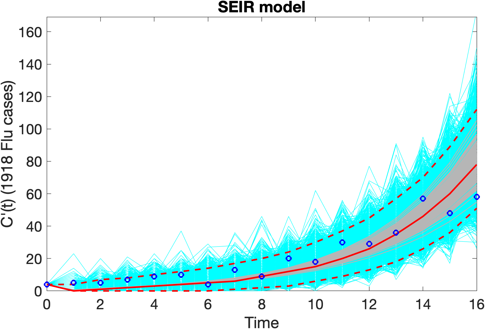
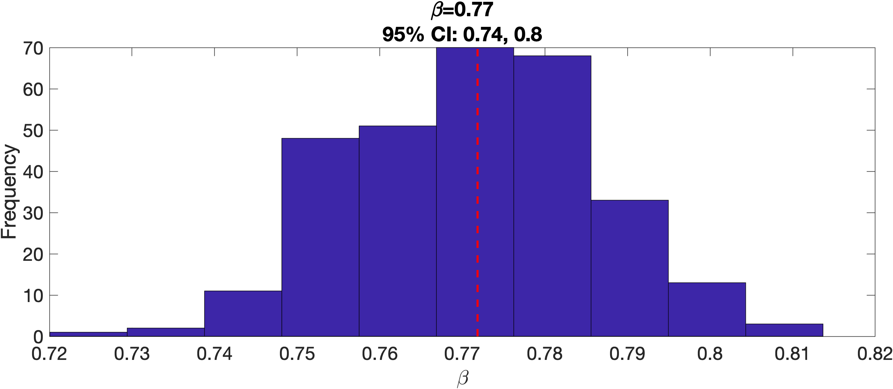
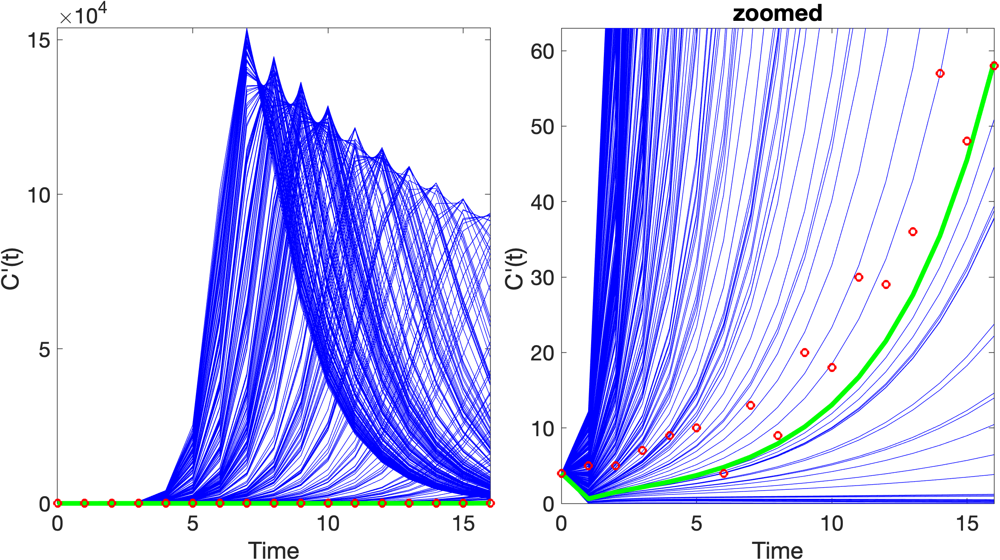
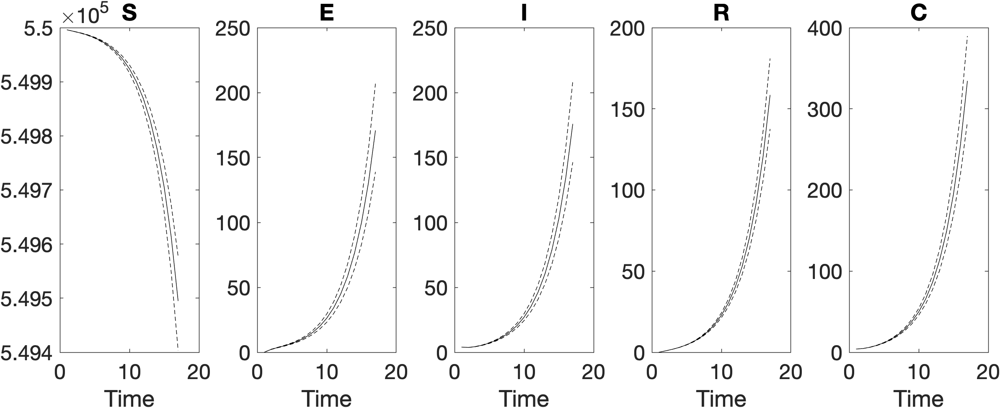

# QuantDiffForecast

QuantDiffForecast fits ordinary differential equation (ODE) models to one or more observed time series in MATLAB. It estimates parameters, generates short-term forecasts with prediction intervals, and evaluates forecasts against held-out observations. The examples below use daily influenza counts from San Francisco in 1918. You can use your own model by specifying its equations and how each observed series relates to a model state.

[Quick start](#quick-start) · [Use your own data](#using-your-own-data) · [Forecast evaluation](#rolling-windows-and-forecast-horizons) · [Profile likelihood](#profile-likelihood) · [Parameter recovery](#practical-identifiability-simulations) · [Output files](#outputs) · [Published tutorial](https://doi.org/10.1002/sim.10036) · [Video tutorial](https://www.youtube.com/watch?v=eyyX63H12sY&t=41s)

## Requirements and installation

The MATLAB source requires **Optimization Toolbox** (`fmincon`), **Global Optimization Toolbox** (`MultiStart`), and **Statistics and Machine Learning Toolbox** (probability distributions and random sampling). **Parallel Computing Toolbox** is optional for parallel optimization and simulation studies.

Download the ZIP from the repository’s **Code** menu, or clone it in a terminal.

```bash
git clone https://github.com/gchowell/QuantDiffForecast-Toolbox.git
```

In MATLAB, set **Current Folder** to the repository root and run the following. Examples below assume the code folder is your current folder. The runners create `output/` there.

```matlab
codeDir = fullfile(pwd, 'forecasting_odemodels code');
assert(isfolder(codeDir), 'Set Current Folder to the repository root first.');
addpath(codeDir);
cd(codeDir);
```

For a short installation check, run `qdfSmokeTest(2)`. It fits and plots a forecast using 20 bootstrap datasets and prints a verdict. The full example below uses 300. Separate Windows and Mac packages are available. The Windows executable requires MATLAB Runtime R2023b. [Smoke test](forecasting_odemodels%20code/qdfSmokeTest.m) · [Standalone packages](stand%20alone%20executable/) · [Windows deployment instructions](stand%20alone%20executable/readme.txt)

## Quick start

### Forecast ten days from the first 17 observations

The bundled susceptible–exposed–infectious–recovered (SEIR) model fits daily counts to increments of state 5, which accumulates transitions from exposed to infectious. It estimates the transmission rate β and negative-binomial dispersion α. The progression rate κ, recovery rate γ and population size N are fixed. The first observed count sets the initial value of state 5. [Data](forecasting_odemodels%20code/input/curve-flu1918SF.txt) · [Model equations](forecasting_odemodels%20code/SEIR1.m) · [Forecast options](forecasting_odemodels%20code/options_forecast_SEIR_flu1918_dist1_3.m)

```matlab
forecastOptions = @options_forecast_SEIR_flu1918_dist1_3;
rng(1, 'twister');
Run_Forecasting_ODEModel(forecastOptions, 1, 1, 17, 10);
```

The two `1` arguments select one window starting at row 1. The runner fits the observed data, refits 300 bootstrap datasets and generates 20 predictive draws per refit. The resulting 6,000 draws include parameter and observation uncertainty.

| Period | MATLAB rows | Time labels in the file | Observed counts at the endpoints |
| --- | --- | --- | --- |
| Calibration | 1–17 | 0–16 | 4 and 58 |
| Held-out forecast targets | 18–27 | 17–26 | 124 and 1,104 |

Read the predictions and scores from the same run. The last score row summarizes the ten held-out days.

```matlab
suffix = ['model_name-SEIR model-fit_index-5-fixI0-1-method-3-dist-3-' ...
          'tstart-1-tend-1-calibrationperiod-17-horizon-10-1918 Flu-cases.csv'];
trajectory = readtable(fullfile('output', ['Forecast-' suffix]));
scores = readtable(fullfile('output', ['performance-forecasting-' suffix]));
disp(trajectory(18:27, {'time','data','median','LB','UB','model_median'}))
disp(scores(end, :))
```

`median`, `LB` and `UB` summarize predicted observations (median and central 95% prediction interval). `model_median` summarizes the refitted model trajectories before observation noise is added. To view the figures, run `plotForecast_ODEModel(forecastOptions, 1, 1, 17, 10)` **after reading the CSV**. The plotter rewrites that file with the first five columns. The six-column table above remains available as `trajectory` in MATLAB. [Forecast runner](forecasting_odemodels%20code/Run_Forecasting_ODEModel.m) · [Forecast plotter](forecasting_odemodels%20code/plotForecast_ODEModel.m)

### Fit parameters without forecasting

Use the fitting runner when the analysis ends at the last calibration observation. It accepts a fitting-options function. The forecast example above performs its own fit.

```matlab
fitOptions = @options_fit_SEIR_flu1918_dist1_3;
rng(1, 'twister');
Run_Fit_ODEModel(fitOptions, 1, 1, 17);
plotFit_ODEModel(fitOptions, 1, 1, 17);
```

To inspect trajectories before fitting, use `plotODEModel(fitOptions)`. Both named quick-start options use method 3, 300 bootstrap datasets and `numstartpoints = 10`. Their starting values and lower bounds for β differ. Calling a runner **without arguments** selects a different options file. The default fit uses Poisson likelihood and 300 bootstrap datasets. The default forecast uses method 3 and 100 bootstrap datasets. [Named fit options](forecasting_odemodels%20code/options_fit_SEIR_flu1918_dist1_3.m) · [Default fit](forecasting_odemodels%20code/options_fit.m) · [Default forecast](forecasting_odemodels%20code/options_forecast.m)

## Using your own data

1. Place a numeric, header-free `.txt` file in the [input folder](forecasting_odemodels%20code/input/). The first column is a consecutive, unit-spaced time index. Each remaining column holds one observed series. Use the observation interval as the time unit for the ODE rates. Resolve missing or irregular observations before fitting.
2. Copy the fit or forecast options file from the quick start. Rename both the file and its first function declaration, keep the output list, and set `cadfilename1` to the input filename. The runners append `.txt` if omitted. Give the analysis a distinct `model.name` so its exports are easy to identify.
3. Map the observed columns to model states, in the same order as the file. Set the model, bounds and observation model in [Configuration](#configuration), then pass the copied options function to the corresponding runner.

### Match observations to model states

For example, suppose the input has columns `time`, `infectious prevalence` and `new cases`. If state 3 is current prevalence and state 5 accumulates new cases, use the following mapping.

```matlab
vars.fit_index = [3, 5];
vars.fit_diff  = [0, 1];
```

| Observed series | Flag | What the toolbox compares with the data |
| --- | ---: | --- |
| State level, such as prevalence or cumulative cases | `0` | The state value at each observation time. |
| Count per interval, such as daily new cases | `1` | `abs([C(1); diff(C)])` for the selected state `C`. The first value uses the initial state. Later values use absolute increments. |

For daily incidence, supply daily counts and choose a nondecreasing cumulative model state. For cumulative observations, use a level mapping. The runner reads each observed column as supplied. Poisson and negative-binomial models require nonnegative integer counts. The count-likelihood runners report negative observations in calibration rows. [Observation mapping](forecasting_odemodels%20code/quantdiffObservationCurve.m)

## Rolling windows and forecast horizons

`tstart1` and `tend1` are the first and last **window-start row indices**, inclusive. To forecast from three successive origins, run the following from the code folder.

```matlab
opts = @options_forecast_SEIR_flu1918_dist1_3;
rng(1, 'twister');
Run_Forecasting_ODEModel(opts, 1, 3, 17, 10);
plotForecast_ODEModel(opts, 1, 3, 17, 10);
```

The last window fits rows 3–19 and forecasts rows 20–29. With `getperformance = 1`, evaluation requires data through row `tend1 + windowsize1 - 1 + forecastingperiod`. If the runner shortens `tend1` to fit the data, use the reported end index in the plotter. For a projection beyond the observed series, set `getperformance = 0` in a copy of the forecast options. The saved `timevect2` grid supplies future time labels where CSV entries are `NaN`.

### Read a forecast score

Each row `h` of `performance-forecasting-*.csv` scores **all leads from 1 through `h`** at one forecast origin. For example, row 10 gives the mean absolute error (MAE), mean squared error (MSE), 95% prediction interval coverage (%) and weighted interval score (WIS) over ten targets. To examine the error at day 10 alone, compare the observed count and predictive median in the tenth held-out row of the trajectory CSV. Lower MAE, MSE and WIS indicate better performance on the same targets. [Point scores and coverage](forecasting_odemodels%20code/computeforecastperformance.m) · [WIS](forecasting_odemodels%20code/computeWIS.m)

### Baselines and forecast ensembles

Compare the quick-start model with a baseline using exactly the same ten targets. The flat baseline centers forecasts on the last calibration observation and samples historical changes. The trend baseline extrapolates a log-linear fit to the last seven observations by default. The following uses the `scores` table from the quick start.

```matlab
data = load(fullfile('input', 'curve-flu1918SF.txt'));
calib = data(1:17, :);
baselineDraws = baselineForecast(calib, 10, 'flat', 6000, 1);
[~, baselineWIS] = computeWIS(calib, data, baselineDraws, 10);
relativeWIS = scores.WIS(end) / baselineWIS(end, 2)
```

A ratio below 1 means the model achieved a lower WIS than the baseline over the ten days. Substitute `'trend'` to evaluate the trend baseline. [Baseline implementation](forecasting_odemodels%20code/baselineForecast.m)

`run_ensemble` combines saved member forecasts for the same series, window and horizon. It supports equal weights (`-1`), Akaike weights (`0` or `1`), inverse calibration WIS (`2`) and softmax calibration WIS (`3`). This workflow requires the external function `getensemble_linearpool_from_curves` on the MATLAB path. The repository includes the single-model and baseline functions, but omits this pooling dependency. [Ensemble interface](forecasting_odemodels%20code/run_ensemble.m) · [Weight definitions](forecasting_odemodels%20code/ensembleWeights.m)

## Profile likelihood

To ask how tightly the observed data constrain a parameter, fix it at successive values and reoptimize the remaining estimated quantities. This example profiles β over the first 17 observations and reestimates negative-binomial dispersion at each point. The profiler performs its own reference fit. [Profile-likelihood runner](forecasting_odemodels%20code/Run_ProfileLikelihood_ODEModel.m) · [Raue et al. (2009)](https://doi.org/10.1093/bioinformatics/btp358)

```matlab
rng(1, 'twister');
opts = struct('paramIndex', 1, 'alpha', 0.05, 'numstartpoints', 3);
PL = Run_ProfileLikelihood_ODEModel(@options_fit_SEIR_flu1918_dist1_3, 1, 17, opts);
disp(PL.referenceStatus)
disp(PL.param(1).status)
disp(PL.param(1).CI)
```

`opts.alpha` sets the significance level for the likelihood-ratio threshold. Read the approximate 95% confidence interval with the reference status and the profile plot. An endpoint at a search bound can reflect the chosen bound. If the optimizer failed or exhausted its search budget, inspect `stopReason` and the explored range before reporting an endpoint. The flatness index (`FI`) is the largest deviance at points free of flagged nuisance-parameter bounds divided by the threshold. A value near zero means the likelihood changed little across those points. Structural identifiability requires a separate analysis.

For a comparison across observation windows and choices of free parameters, run `plot_PL_1918_examples`. The script clears the workspace and produces a 12-panel figure from six configurations, including a simulated series with known parameters. [Profile examples](forecasting_odemodels%20code/plot_PL_1918_examples.m)

## Practical identifiability simulations

To evaluate recovery under a specified observation design, simulate series with known parameter values, refit each series and check how often its bootstrap interval contains the truth. The bundled exponential-growth study estimates the growth rate `r` and dispersion α. Its generating values are `r = 0.18` and `α = 5`, with negative-binomial variance $\mu + 5\mu$. [Study script](forecasting_odemodels%20code/plotPracticalIdentifiabilityResults.m) · [Study options](forecasting_odemodels%20code/options_forecast_PII_EXPO_r_dist1_3.m)

Edit **USER SETTINGS** in `plotPracticalIdentifiabilityResults.m`, then run the script by name. It clears the workspace at startup. The shipped settings compare windows of 30, 40 and 50 observations, with 20 simulated datasets per window and 300 bootstrap refits per dataset. The replicate number seeds the simulation across window lengths, so comparisons by replicate are paired. For a short check of this workflow, `qdfSmokeTest3(1)` uses two replicates at one window length.

```matlab
plotPracticalIdentifiabilityResults
```

Open `output/EXP_Negbin3-alpha5_W30-10-50/recovery_summary.csv`. Each row represents one parameter and one window length.

| Question | Columns to read | Interpretation |
| --- | --- | --- |
| How many replicates contributed? | `files`, `converged` | Result files found and replicates eligible for summary. A documented failed point fit or mismatched noise record excludes a replicate. |
| Are the estimates close to the truth? | `truth`, `bias_MLE`, `RMSE_MLE`, `bias_bootmedian` | Bias measures systematic error. RMSE also reflects variability. Compare the fitted point estimate with the bootstrap median for evidence of skew or boundary effects. |
| Do the intervals cover the truth? | `coverage95`, `coverage_MCSE` | Empirical coverage is a **fraction**. With 20 eligible replicates, one missed interval changes coverage by 0.05. |
| How wide are the intervals? | `PII_scale`, `median_PII`, `median_rangeFrac`, `frac_bound_hits` | Interpret width on the selected scale and check how often estimates accumulate at optimizer bounds. |

In the default study, **read `median_rangeFrac` for `r`** because its optimizer bounds are [0, 10]. For α, the lower bound is positive, so read `median_PII`. Use `run_flag = false` to summarize existing files. Changing truth, constraints or bootstrap settings calls for a distinct results folder and simulated-input base name (`cadfilename1`), since the script skips completed window/replicate pairs. The input files have companion `-noise.mat` records. For Poisson and likelihood-based negative-binomial studies, the summary checks available records against the requested settings. Older results with missing records can enter the summary with a warning. [Recovery summary implementation](forecasting_odemodels%20code/summarizeIdentifiability.m)

<details>
<summary>Interval-width measures and simulation options</summary>

For bootstrap interval endpoints $L,U$ and optimizer bounds $L_b,U_b$, the reported measures are as follows.

| Measure | Definition |
| --- | --- |
| Parameter identifiability index (PII), stored as `SCI` | $\log_{10}(U/L)$ when both endpoints are positive. A value of 1 means the interval spans a factor of ten. `n_PII_undefined` counts replicates without a defined log width. |
| `PII_rangeFrac` | $(U-L)/(U_b-L_b)$, clipped to [0, 1] for a free parameter. A value of 0.8 means the interval covers 80% of its allowed linear range. |
| `PII_box`, `PII_ratio` | The log span of positive optimizer bounds and the interval’s share of that span. On the range-fraction scale, `PII_ratio` equals `PII_rangeFrac`. |
| `fracLB`, `fracUB` | Fractions of bootstrap estimates at the lower and upper bounds, using a tolerance of 0.1% of each bound’s magnitude. `frac_bound_hits` counts the fraction of replicates with `fracLB + fracUB > 0.05`. |

Set `params.PIIscale` by parameter slot to `1` (log width), `0` (range fraction) or `NaN` (automatic). Read width alongside coverage and bound hits. Bootstrap estimates concentrated at one bound can give a narrow interval with poor coverage. [Index definitions](forecasting_odemodels%20code/quantdiffPII.m) · [Bound-hit definitions](forecasting_odemodels%20code/boundHitFractions.m)

To simulate one dataset without fitting, or to fit selected replicates directly, use a forecast-type options function.

```matlab
studyOpts = @options_forecast_PII_EXPO_r_dist1_3;
rng(1, 'twister');
[states, observations, noiseTruth] = Run_simulate_ODEModel(studyOpts, 30, 5);
outDir = fullfile(pwd, 'output', 'EXP_Negbin3-alpha5_W30');
Run_PracticalIdentifiability_ODEModel(studyOpts, 30, 5, 2, [], outDir);
```

The simulator returns noise-free states, a matrix of time and noisy observations, and the generating noise settings. For method 5, choose the bundled method-5 options and pass `[alpha d]` as the noise factor for variance $\mu+\alpha\mu^d$. A scalar sets $d=1$. An empty noise factor uses `[0.5 1.5]` for method 5. [Simulator](forecasting_odemodels%20code/Run_simulate_ODEModel.m) · [Replicate runner](forecasting_odemodels%20code/Run_PracticalIdentifiability_ODEModel.m) · [Method-5 options](forecasting_odemodels%20code/options_forecast_PII_EXPO_r_dist1_5.m)

</details>

## Configuration

The fitting and profile runners expect a fit-type options function (13 outputs). Forecasting, simulation and parameter recovery use a forecast-type function (15 outputs). Keep the output order when you copy a template. Explicit window and horizon arguments in a runner call override the corresponding options.

| Setting | What to specify |
| --- | --- |
| `cadfilename1`, `caddisease`, `datatype` | Input filename, dataset label and observed quantity. The labels appear in output filenames. |
| `model.fc`, `model.name` | ODE function handle and a label for this model or analysis. |
| `params.label`, `params.initial`, `params.LB`, `params.UB` | Parameter names, starting values and finite bounds in the order used by the ODE. Starting values must lie within the bounds. |
| `params.fixed`, `params.fixI0` | `fixed = 1` holds the corresponding parameter at its initial value. `fixI0 = 1` pins each fitted state’s initial value to its first observation. Set a parameter’s `fixed` entry to `0` to estimate it, or set `fixI0 = 0` to estimate the fitted states’ initial values. Bootstrap datasets retain the first observation of each series in both cases. |
| `vars.label`, `vars.initial`, `vars.fit_index`, `vars.fit_diff` | State names, initial conditions, observed-state indices and level/increment flags. |
| `params.composite`, `params.composite_name`, `params.extra0` | Optional derived-quantity function and label, and extra data passed to the ODE. Set the function to `[]` when unused. |
| `method1`, `dist1` | Fitting objective and observation-noise model. The options function sets the global `method1`. See the combinations below. |
| `B`, `numstartpoints` | Bootstrap datasets per window and starting-point budget for the original fit. The optimizer also adds seed and perturbed starts. |
| `windowsize1`, `forecastingperiod`, `tstart1`, `tend1` | Calibration length, forecast length, first window-start row and last window-start row. |
| `getperformance`, `printscreen1` | Enable forecast evaluation/export and selected displays, respectively. Some scoring and console output also occur with these flags off. |

### Estimation methods and observation models

| `method1` | `dist1` | Fitting objective | Noise for bootstrap and prediction |
| ---: | ---: | --- | --- |
| 0 | 0 | Least squares | Gaussian |
| 0 | 1 | Least squares | Poisson |
| 0 | 2 | Least squares | Negative binomial with variance `factor1 * mu` estimated from Pearson residuals |
| 1 | 1 | Poisson likelihood | Poisson with variance $\mu$ |
| 3 | 3 | Negative-binomial likelihood | Variance $\mu+\alpha\mu$ |
| 4 | 4 | Negative-binomial likelihood | Variance $\mu+\alpha\mu^2$ |
| 5 | 5 | Negative-binomial likelihood | Variance $\mu+\alpha\mu^d$ |
| 6 | 6 | Sum of absolute deviations | Laplace with scale estimated from absolute residuals |

Here $\mu$ is the predicted observation, $\alpha$ is dispersion and $d$ is the variance exponent. For positive method codes, the runners set `dist1 = method1`. For method 0, all three noise choices produce the same unweighted least-squares objective. Code 2 is available only for `dist1`. If its estimated variance-to-mean factor is unavailable or at most one, that window uses Poisson draws and retains `dist-2` in filenames. Gaussian and Laplace noise can yield negative draws. The runners warn when the expected negative fraction exceeds 5% and record it in `noiseLog`. [Pearson dispersion](forecasting_odemodels%20code/estimatePearsonDispersion.m) · [Laplace scale](forecasting_odemodels%20code/estimateLaplaceScale.m) · [Negative-draw diagnostic](forecasting_odemodels%20code/quantdiffNegativeNoiseShare.m)

<details>
<summary>Optimizer settings and AICc</summary>

The named quick-start options request parallel local fits. Set `params.useParallel = false` in a copy for serial fitting. If a parallel pool is unavailable, the optimizer falls back to serial execution. With `params.logscale = true`, free coordinates with positive lower bounds are searched on a log scale and reported in their original units.

| Optional field | Default when omitted | Purpose |
| --- | --- | --- |
| `params.useParallel`, `params.logscale` | `false`, `false` | Parallel local fits and log-scale search, respectively |
| `params.optimOptions` | `[]` | Override selected `fmincon` settings |
| `params.polish` | `false` | Try Nelder–Mead refinement and retain an improved objective |
| `params.polish_gradient_tol`, `params.polish_budget` | `1e-2`, `100` | Refinement gradient threshold and evaluation budget per free parameter |

For $s$ observed series and $W$ rows per series, the effective sample size is $s(W-1)$ when initial observations are pinned and $sW$ when the initial values are estimated. The corrected Akaike information criterion (AICc) requires at least $k+2$ informative observations for $k$ estimated quantities. The quick start has 16 informative observations and two estimated quantities (β and α). Least-squares AICc includes one Gaussian variance regardless of bootstrap noise. Method 6 uses the Laplace likelihood and counts its scale. Count-likelihood AICc restores the data-dependent log-factorial term and removes the pinned first observations’ contribution. Compare AICc values for the same responses, calibration rows and initial-value treatment. [Optimizer](forecasting_odemodels%20code/fit_model.m) · [AICc](forecasting_odemodels%20code/getAICc.m) · [Effective sample size](forecasting_odemodels%20code/quantdiffEffectiveN.m)

</details>

## Outputs

All paths below are relative to `forecasting_odemodels code/output/`. A forecast trajectory is saved for each observed series and window. For parameter estimates, start with the parameter CSV and then check the corresponding MAT file for convergence and bound diagnostics.

| File or prefix | What it contains |
| --- | --- |
| `Forecast-model_name-*.csv` | Observations, predictive median, 95% prediction limits and the runner’s `model_median`. The forecast plotter rewrites the file with five columns and uses the raw predictive median. The runner clips its exported medians and limits at zero. |
| `performance-calibration-*.csv`, `performance-forecasting-*.csv` | MAE, MSE, 95% prediction interval coverage (%) and WIS. Use the forecasting file for held-out evaluation. |
| `quantile-*.csv`, `StateVars-*.csv` | The plotter exports 23 predictive quantiles from 0.01 to 0.99. State files summarize bootstrap trajectories. In rolling runs, successive windows reuse the same state CSV filename. Run one start at a time to keep one state CSV per origin. |
| `parameters-rollingwindow-*.csv`, `parameters-composite-*.csv` | Point estimates from the observed data and 2.5th/97.5th bootstrap percentiles. For a derived quantity, the central estimate is its value at the observed-data fit. |
| `AICc-*.csv` | AICc, its two additive components and the count of estimated quantities. |
| `SCIs-rollingwindow-*.csv`, `PII*-rollingwindow-*.csv` | Log width, optimizer-box width, normalized width, range fraction, selected scale and bound-hit fractions. |
| `MCSEs-rollingwindow-*.csv` | Monte Carlo standard errors of interval endpoints and log width, estimated by resampling the bootstrap estimates 500 times. `_SE_bootmean` is the standard error of the bootstrap mean. |
| `bootstraps-ODEModel-*.mat`, `parameters-ODEModel-*.mat` | Bootstrap estimates and noise details in the former. Parameter summaries, `param_bootmedian`, `estimOutsideCI` and optimizer diagnostics (`numericalAudit`) in the latter. |
| `Forecast-ODEModel-*.mat` | Saved forecast for a window and fitted series. `forecast1` contains bootstrap model trajectories for that series. `forecast2` includes observation noise. |
| `PLsummary-*.csv`, `PLprofile-param-*.csv`, `PL-*.mat` | Profile intervals and status, pointwise profiles and the full profile result. The default run also saves a PNG. |
| `results_W<W>_rep<r>.mat`, `recovery_summary.csv` | Results for each simulated replicate and the recovery summary in the study folder. |

The runners report requested, accepted and unresolved bootstrap fits. Unresolved refits can still enter interval estimates, so inspect `numericalAudit` before interpreting narrow intervals. Save the seed, options file, source revision and outputs together. Changing `B`, parameter bounds or optimizer settings can reuse the same filenames.

## Adding a model

Place the ODE function in the code folder. It takes four inputs (time, states, parameters and `params.extra0`) and returns a column vector of derivatives in state order. The solver enforces nonnegative states. The bundled exponential-growth model is a complete one-state example. [EXP.m](forecasting_odemodels%20code/EXP.m) · [SEIR1.m](forecasting_odemodels%20code/SEIR1.m) · [Solver settings](forecasting_odemodels%20code/quantdiffODEOptions.m)

For example, copy a quick-start options function, rename it, and replace the model-specific assignments with the following to fit increments of $C$ under $dC/dt=rC$ using the existing `EXP.m`. Retain the data, estimation and window settings from the template. For your own equations, replace `@EXP` with a handle to your four-input function.

```matlab
model.fc = @EXP;
model.name = 'Exponential growth';
params.label = {'r'};
params.initial = 0.1;
params.LB = 0;
params.UB = 1;
params.fixed = 0;
params.fixI0 = 1;
params.composite = [];
params.composite_name = '';
params.extra0 = [];

vars.label = {'C'};
vars.initial = 4;
vars.fit_index = 1;
vars.fit_diff = 1;
```

A composite function receives a matrix with one row per parameter draw and returns one value per row. The bundled SEIR example computes $R_0=\beta/\gamma$ across those rows. [Composite example](forecasting_odemodels%20code/R0s.m)

## Example visualizations

The repository figures illustrate fits, forecast uncertainty and parameter estimates. Their exact values depend on the options and random draws used to generate them.

<table>
  <tr>
    <td width="50%" align="center">
      <br>
      <sub>Model fit</sub>
    </td>
    <td width="50%" align="center">
      <br>
      <sub>Forecast with uncertainty</sub>
    </td>
  </tr>
  <tr>
    <td width="50%" align="center">
      <br>
      <sub>Parameter estimates (κ, γ, and N are fixed)</sub>
    </td>
    <td width="50%" align="center">
      <br>
      <sub>Basic reproduction number</sub>
    </td>
  </tr>
</table>

<details>
<summary>Additional model-state and forecast-performance illustrations</summary>






</details>

## Checks and support

| Task or symptom | Command or remedy |
| --- | --- |
| Check input validation | `qdfSmokeTest([7 8])` checks that unsupported methods and negative count observations are caught. |
| Exercise the main workflows | `qdfSmokeTest()` runs the first eight tests. `qdfSmokeTest2()` adds ten checks, including multiple series and rolling windows. `qdfSmokeTest3(1:3)` covers recovery plotting, a fit with three free model parameters and a profile of κ. |
| MATLAB cannot find a function | Run `which Run_Forecasting_ODEModel -all` and `ver` to check the active source folder and installed products. |
| The plotter cannot find a forecast | Use the options and effective window indices, calibration length and horizon from the completed forecast. |
| The options function returns too few outputs | Use a fit-type template for fitting or profiling and a forecast-type template for forecasting or simulation. |

The fourth test in `qdfSmokeTest3` requires the Spain dataset (`curve-cases-covid-spain.txt`) and the functions `SEIR_unreported.m` and `R0s_unreported.m`. These files are absent from this distribution. [First test suite](forecasting_odemodels%20code/qdfSmokeTest.m) · [Second suite](forecasting_odemodels%20code/qdfSmokeTest2.m) · [Third suite](forecasting_odemodels%20code/qdfSmokeTest3.m)

For a software issue, include the command, options file, source revision, MATLAB version, error text and a small shareable dataset. For scientific questions, contact Gerardo Chowell at Georgia State University. [GitHub Issues](https://github.com/gchowell/QuantDiffForecast-Toolbox/issues) · [gchowell@gsu.edu](mailto:gchowell@gsu.edu)

## Citation

Chowell G, Bleichrodt A, Luo R. Parameter estimation and forecasting with quantified uncertainty for ordinary differential equation models using QuantDiffForecast: A MATLAB toolbox and tutorial. *Statistics in Medicine*. 2024, 43(9), 1826–1848. [DOI](https://doi.org/10.1002/sim.10036) · [PubMed](https://pubmed.ncbi.nlm.nih.gov/38378161/)

<details>
<summary>BibTeX</summary>

```bibtex
@article{Chowell2024QuantDiffForecast,
  author  = {Gerardo Chowell and Amanda Bleichrodt and Ruiyan Luo},
  title   = {Parameter estimation and forecasting with quantified uncertainty
             for ordinary differential equation models using {QuantDiffForecast}:
             A {MATLAB} toolbox and tutorial},
  journal = {Statistics in Medicine},
  year    = {2024},
  volume  = {43},
  number  = {9},
  pages   = {1826--1848},
  doi     = {10.1002/sim.10036}
}
```

</details>

For background on fitting dynamic models and quantifying uncertainty, see [Chowell (2017)](https://doi.org/10.1016/j.idm.2017.08.001).

## License

This toolbox is distributed under CC0 1.0 Universal. [License](LICENSE)
