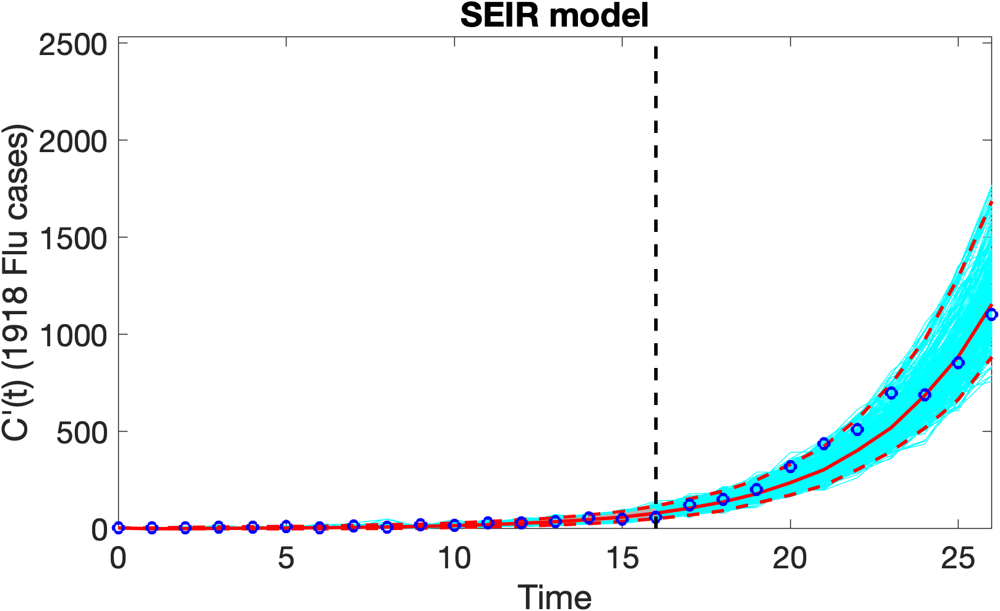
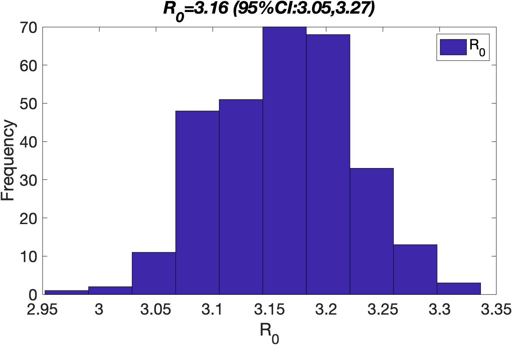

# QuantDiffForecast

QuantDiffForecast is a MATLAB toolbox for fitting ordinary differential equation (ODE) models to one or more observed time series, quantifying parameter uncertainty, and evaluating short-term forecasts. The bundled example fits a susceptible–exposed–infectious–recovered (SEIR) model to the 1918 San Francisco influenza series. The same workflow accepts a user-defined ODE and an observation rule for each measured series.

[Quick start](#quick-start) · [Using your own data](#using-your-own-data) · [Configuration](#configuration) · [Forecast evaluation](#rolling-windows-and-forecast-horizons) · [Profile likelihood](#profile-likelihood) · [Parameter recovery](#practical-identifiability-simulations) · [Outputs](#outputs) · [Published tutorial](https://doi.org/10.1002/sim.10036) · [Video tutorial](https://www.youtube.com/watch?v=eyyX63H12sY&t=41s)

## Requirements and installation

The source workflow uses MATLAB with **Optimization Toolbox** (`fmincon`), **Global Optimization Toolbox** (`MultiStart`) and **Statistics and Machine Learning Toolbox** (sampling, distributions and profile thresholds). **Parallel Computing Toolbox** is optional. The fitting functions can parallelize local solves, and the parameter-recovery script can parallelize independent replicates.

Download and extract the repository ZIP or clone it in a terminal.

```bash
git clone https://github.com/gchowell/QuantDiffForecast-Toolbox.git
```

In MATLAB, set **Current Folder** to the repository root, then run the following. The code folder name contains a space. The runners create `output/` as needed.

```matlab
codeDir = fullfile(pwd, 'forecasting_odemodels code');
assert(isfolder(codeDir), 'Set Current Folder to the repository root first.');
addpath(codeDir);
cd(codeDir);
```

For the compiled Windows application, the deployment instructions specify MATLAB Runtime **R2023b**. The current MATLAB source and the packaged application have separate release histories. [Standalone applications](stand%20alone%20executable/) · [Deployment instructions](stand%20alone%20executable/readme.txt)

## Quick start

### Fit the first 17 observations and forecast the next 10

This example uses the bundled 1918 influenza data. It estimates the transmission rate β and negative-binomial dispersion α. The transition rate κ, recovery rate γ, population size N and the initial value of the observed state are fixed. State 5 accumulates transitions from exposed to infectious, and its increments are fitted to the observed counts. [Example data](forecasting_odemodels%20code/input/curve-flu1918SF.txt) · [SEIR equations](forecasting_odemodels%20code/SEIR1.m)

```matlab
fitOptions = @options_fit_SEIR_flu1918_dist1_3;
forecastOptions = @options_forecast_SEIR_flu1918_dist1_3;

rng(1, 'twister');
Run_Fit_ODEModel(fitOptions, 1, 1, 17);
plotFit_ODEModel(fitOptions, 1, 1, 17);

rng(1, 'twister');
Run_Forecasting_ODEModel(forecastOptions, 1, 1, 17, 10);
```

The two `1` arguments select a single window starting at row 1. Rows 1–17 are the calibration data and rows 18–27 are the ten forecast targets. You can run the forecast independently. The forecast runner fits the observed data, simulates and refits 300 bootstrap datasets, then generates 20 predictive draws per refit. The 6,000 draws represent uncertainty in both the parameters and the observations.

Read the runner’s trajectory CSV before calling the plotter to retain both medians. For this example, the first and last held-out counts are 124 and 1,104, with input time labels 17 and 26. Each of the ten displayed rows contains one observed target and its prediction.

```matlab
file = ['Forecast-model_name-SEIR model-fit_index-5-fixI0-1-method-3-dist-3-' ...
        'tstart-1-tend-1-calibrationperiod-17-horizon-10-1918 Flu-cases.csv'];
trajectory = readtable(fullfile('output', file));
disp(trajectory(18:27, {'time','data','median','LB','UB','model_median'}));

plotForecast_ODEModel(forecastOptions, 1, 1, 17, 10);
```

Here `median` includes observation noise and `model_median` summarizes the refitted model trajectories before observation noise is added. The plotter reads the saved MAT files and rewrites the trajectory CSV with five columns (`time`, `data`, `median`, `LB`, `UB`). Use matching options and window arguments in the runner and plotter.

### Default settings

| Entry point or options choice | Fit criterion | Bootstrap datasets per window | Calibration observations | Forecast steps |
| --- | --- | ---: | ---: | ---: |
| Fit runner without arguments, using [options_fit.m](forecasting_odemodels%20code/options_fit.m) | Poisson likelihood | 300 | 17 | 0 |
| Forecast runner without arguments, using [options_forecast.m](forecasting_odemodels%20code/options_forecast.m) | Negative-binomial likelihood, method 3 | 100 | 17 | 10 |
| Named [fit](forecasting_odemodels%20code/options_fit_SEIR_flu1918_dist1_3.m) and [forecast](forecasting_odemodels%20code/options_forecast_SEIR_flu1918_dist1_3.m) options used above | Negative-binomial likelihood, method 3 | 300 each | 17 | 0 for fit, 10 for forecast |

Both named examples use `numstartpoints = 10`, `params.fixI0 = 1` and `params.useParallel = true`. They use different starting values and lower bounds for β. For a serial run, set `params.useParallel = false` in a copy of the options file. For a shorter installation check, reduce `B` in the copy. To inspect trajectories at the supplied parameter values and across the parameter bounds before fitting, run `plotODEModel(fitOptions)`.

## Profile likelihood

Use [`Run_ProfileLikelihood_ODEModel.m`](forecasting_odemodels%20code/Run_ProfileLikelihood_ODEModel.m) to assess practical identifiability by fixing one parameter at a time and reoptimizing the remaining estimated quantities (Raue et al., 2009). The function performs its own reference fit.

From `forecasting_odemodels code`, profile the transmission rate β (`paramIndex = 1`) using observations 1–17 of the SEIR example:

```matlab
rng(1, 'twister');
opts = struct('paramIndex', 1, 'alpha', 0.05, 'numstartpoints', 3);
PL = Run_ProfileLikelihood_ODEModel( ...
    @options_fit_SEIR_flu1918_dist1_3, 1, 17, opts);

PL.referenceStatus
PL.param(1).CI
PL.param(1).status
PL.param(1).FI
```

Here, `opts.alpha = 0.05` requests an approximate 95% confidence interval using a likelihood-ratio threshold. The negative-binomial dispersion is reestimated at each profile point. Results are saved in `output` as `PLsummary-*.csv`, `PLprofile-param-*.csv`, `PL-*.mat`, and, by default, `PLprofiles-*.png`.

The flatness index (`PL.param(k).FI`) is `maxDclean / threshold`, where `maxDclean` is the largest profile deviance at points without flagged bound activity in the other estimated quantities. Values near zero indicate a nearly flat profile over these points. Interpret FI together with `status`, `explored`, and `stopReason`, because it depends on the explored range and stopping rule.

Inspect `PL.referenceStatus`, `PL.param(1).status`, and the profile plot before interpreting the interval. Flat, bound-limited, or unresolved profiles require checking parameter bounds and numerical diagnostics; a numerically flat profile alone does not prove structural non-identifiability.

Reference: Raue A, Kreutz C, Maiwald T, et al. Structural and practical identifiability analysis of partially observed dynamical models by exploiting the profile likelihood. *Bioinformatics*. 2009;25(15):1923–1929. [doi:10.1093/bioinformatics/btp358](https://doi.org/10.1093/bioinformatics/btp358).

## Practical identifiability simulations

Profile likelihood examines one observed dataset. A parameter-recovery study instead simulates many datasets with known parameter values and asks how well the fitting procedure recovers them. Use the study to examine bias, interval coverage and interval width as the calibration window grows.

From the code folder, run the study script. To change the study, edit the **USER SETTINGS** block inside the script. It clears the workspace when it starts. [Study script](forecasting_odemodels%20code/plotPracticalIdentifiabilityResults.m)

```matlab
plotPracticalIdentifiabilityResults
```

| Script setting | Shipped value | Meaning |
| --- | --- | --- |
| `options_handle` | `@options_forecast_PII_EXPO_r_dist1_3` | Exponential growth with true rate `r = 0.18`, negative-binomial noise and 300 bootstrap refits per simulated series. |
| `noise_factor` | `5` | True dispersion α for method 3, giving variance $\mu+5\mu$. The script derives the noise label from the options and this value. |
| `windowsize1` | `30:10:50` | Compare 30, 40 and 50 calibration observations. |
| `num_replicates` | `20` | Simulated datasets per window length. The replicate number seeds the random stream across window lengths. |
| `run_flag`, `use_parallel` | `true`, `true` | Run missing replicates and use parallel workers when available. Set `run_flag = false` to summarize existing results. |
| `plot_type` | `'both'` | Produce interval-width plots and a grid of parameter intervals. Other choices are `'PII'`, `'CI_grid'` and `'none'`. |

The default study writes to **`output/EXP_Negbin3-alpha5_W30-10-50/`**. Open `recovery_summary.csv` first. Each row describes one estimated parameter at one window length. The table reports generating truth, files found, eligible replicates (`converged`), bias and RMSE of the observed-data estimate, bias of the bootstrap median, empirical 95% coverage and its Monte Carlo standard error, interval widths and bound hits. Interpret coverage using its replicate count. For example, with 20 eligible replicates each missed interval changes coverage by five percentage points. [Recovery summary](forecasting_odemodels%20code/summarizeIdentifiability.m)

To simulate a dataset without fitting, or fit selected replicates directly, use a **forecast-type** options function. The first call below returns noise-free state trajectories, noisy observations and the generating noise settings. The second fits two simulated datasets, writing their results to the specified folder.

```matlab
studyOptions = @options_forecast_PII_EXPO_r_dist1_3;
rng(1, 'twister');
[Ys, curves, noiseTruth] = Run_simulate_ODEModel(studyOptions, 30, 5);

outDir = fullfile(pwd, 'output', 'EXP_Negbin3-alpha5_W30');
Run_PracticalIdentifiability_ODEModel(studyOptions, 30, 5, 2, [], outDir);
```

For power-law negative-binomial variance $\mu+\alpha\mu^d$, use the bundled method-5 study and pass `noise_factor = [alpha d]`, for example `[0.5 1.5]`. A scalar sets $d=1$. An empty value uses the method-5 simulator default `[0.5 1.5]`. [Method-3 options](forecasting_odemodels%20code/options_forecast_PII_EXPO_r_dist1_3.m) · [Method-5 options](forecasting_odemodels%20code/options_forecast_PII_EXPO_r_dist1_5.m) · [Simulator](forecasting_odemodels%20code/Run_simulate_ODEModel.m)

The study reuses result files with matching window and replicate numbers. When changing the generating parameters, bounds, or bootstrap settings, use a distinct results folder and input base name (`cadfilename1`). Each simulated input has a companion `-noise.mat` file. The summary excludes replicates with a documented unconverged point fit. For Poisson and likelihood-based negative-binomial studies, it also excludes replicates with mismatched recorded noise settings. Older files without noise records can still enter the summary with a warning.

### Reading interval width and bound hits

Let $L,U$ be the 2.5th and 97.5th percentiles of the bootstrap estimates, and $L_b,U_b$ the optimizer bounds. The toolbox reports the following measures. [Index definitions](forecasting_odemodels%20code/quantdiffPII.m) · [Reader for current and older results](forecasting_odemodels%20code/quantdiffReadPII.m)

| Measure | Calculation and interpretation |
| --- | --- |
| Log-scale parameter identifiability index (PII), saved as `SCI` | $\log_{10}(U/L)$ when both endpoints are positive. A value of 1 means the interval spans a factor of ten. A nonpositive endpoint gives `NaN`. This is the default summary when the optimizer lower bound is positive. |
| `PII_rangeFrac` | $(U-L)/(U_b-L_b)$, clipped to [0, 1]. This is the default summary when the optimizer lower bound is zero or negative. A value of 0.8 means the interval occupies 80% of the allowed range. |
| `PII_box`, `PII_ratio` | For positive bounds, `PII_box` is $\log_{10}(U_b/L_b)$. On the log scale, `PII_ratio` divides the interval PII by that span. On the range-fraction scale, `PII_ratio` equals `PII_rangeFrac`. A ratio near 1 means the interval occupies nearly the whole allowed range on the selected scale. |
| `fracLB`, `fracUB` | Fractions of bootstrap estimates at the lower and upper optimizer bounds, using a tolerance of 0.1% of each bound’s absolute value. A zero bound requires an exact hit. The recovery summary's `frac_bound_hits` gives the fraction of replicates for which `fracLB + fracUB > 0.05`. |

In `recovery_summary.csv`, read `median_PII` when `PII_scale = 1` and `median_rangeFrac` when `PII_scale = 0`. The column `n_PII_undefined` counts replicates without a defined log-scale width. To override the automatic choice for individual parameters, set `params.PIIscale` to `1` (log), `0` (range fraction) or `NaN` (automatic) in parameter-slot order. Fixed slots have no search width. Read a narrow interval alongside the bound-hit fractions and empirical coverage. For example, many refits at the lower bound can produce a narrow interval even when recovery of the true value is poor.

## Example visualizations

These repository illustrations show the types of figures the toolbox produces. Exact results depend on the configuration, random draws and software version.

<table>
  <tr>
    <td width="50%" align="center">
      <br>
      <sub>Model fit</sub>
    </td>
    <td width="50%" align="center">
      <br>
      <sub>Forecast with uncertainty</sub>
    </td>
  </tr>
  <tr>
    <td width="50%" align="center">
      <br>
      <sub>Parameter estimates (κ, γ, and N are fixed)</sub>
    </td>
    <td width="50%" align="center">
      <br>
      <sub>Derived quantity: basic reproduction number</sub>
    </td>
  </tr>
</table>

<details>
<summary>Additional model-state and forecast-performance illustrations</summary>


</details>

## Using your own data

Place a numeric, header-free text file in [`forecasting_odemodels code/input`](forecasting_odemodels%20code/input/). Set `cadfilename1` in the options file to its name; the main runners append `.txt` when it is omitted.

```text
0   4
1   5
2   5
3   7
4   9
```

The first column is the **time index**. Every remaining column is an observed series to be fitted. Use consecutive, unit-spaced indices such as `0, 1, 2, ...`; the main runners use `DT = 1`. Keep a separate mapping to calendar dates when needed. Prepare missing or irregularly spaced observations upstream rather than passing `NaN`, `Inf`, or irregular intervals to the fitting workflow.

For Poisson and negative-binomial likelihoods, supply nonnegative integer counts. The runners reject negative observations in the calibration rows and report the affected rows and series. Resolve revisions and missing intervals before fitting. Use a continuous observation model for continuous measurements.

### Match observations to model states

`vars.fit_index` identifies the state corresponding to each observed column, and `vars.fit_diff` specifies its transformation. For one series derived from state 5:

```matlab
vars.fit_index = 5;
vars.fit_diff = 1;
```

For two series corresponding to states 3 and 5, with the first fitted as a level and the second as an increment:

```matlab
vars.fit_index = [3, 5];
vars.fit_diff = [0, 1];
```

These vectors must have the same length as the number of observed columns, in the same order. Do not add unused covariate columns to the input file.

With `fit_diff = 0`, the model observation is the state value. With `fit_diff = 1`, it is `abs([C(1); diff(C)])`, the initial state followed by absolute interval increments. For incidence, use a nondecreasing cumulative state and check that its initial value represents the first observation. [Observation mapping](forecasting_odemodels%20code/quantdiffObservationCurve.m)

The runners take the observed columns as supplied. For a cumulative input series, provide cumulative observations with a level mapping, or convert the data to incidence before using an increment mapping.

## Configuration

For a new analysis, copy one of the quick-start options files. Rename both the `.m` file and the function declared on its first function line, retaining its output list. Edit the copy rather than changing the shared example. Use a fitting-options function with `Run_Fit_ODEModel` and a forecasting-options function with `Run_Forecasting_ODEModel`; their output lists differ.

### Main settings

| Setting | Meaning |
| --- | --- |
| `cadfilename1` | Input filename under `input`. |
| `caddisease`, `datatype` | Labels used in figures and output filenames. |
| `method1` | Global variable set inside the options function; selects the fitting objective. |
| `dist1` | Observation-noise distribution used for bootstrap and predictive sampling. For supported positive `method1` values, the runners set `dist1 = method1`. |
| `numstartpoints` | Initial-fit exploration budget. The fitter also adds a seed and jittered starts; this is not the total number of local solves. |
| `B` | Number of synthetic bootstrap datasets to fit. |
| `model.fc`, `model.name` | ODE function handle and model label. |
| `params.label` | Parameter names, in the order expected by the ODE function. |
| `params.initial`, `params.LB`, `params.UB` | Starting values and finite lower/upper bounds; starting values must lie within bounds. |
| `params.fixed` | `1` fixes a parameter at its initial value; `0` estimates it. |
| `params.fixI0` | `1` fixes initial values of the selected fitted states to the first observations; `0` estimates those initial values. Bootstrap datasets retain each series' original first observation even when `params.fixI0 = 0`. |
| `params.composite`, `params.composite_name` | Optional function and label for a derived quantity; use `[]` for no composite function. |
| `params.extra0` | Additional information passed to the ODE callback. |
| `vars.label`, `vars.initial` | State names and initial conditions. |
| `vars.fit_index`, `vars.fit_diff` | Observed-state indices and level/increment flags, in input-column order. |
| `windowsize1` | Number of observations in each calibration window. |
| `tstart1`, `tend1` | First and last **window-start row indices**, inclusive; these are not calendar dates. |
| `forecastingperiod` | Number of forecast steps beyond the calibration window. |
| `getperformance` | Controls forecast-performance output in the forecasting workflow; it is not a global switch disabling all score calculations. |
| `printscreen1` | Controls selected displays; setting it to `0` does not guarantee a completely silent or figure-free run. |

The main runners infer `params.num` and `vars.num` from their label vectors. Keep parameter and state vectors internally consistent. Explicit window and horizon arguments in the function call override their defaults in the options file.

### Optimizer settings (optional)

The following defaults apply when the fields are omitted. The named quick-start files set them explicitly. [Optimizer](forecasting_odemodels%20code/fit_model.m)

| Setting | Default | Meaning |
| --- | --- | --- |
| `params.useParallel` | `false` | `true` runs the `MultiStart` local solves of every fit, including the bootstrap refits, on a parallel pool (Parallel Computing Toolbox). The pool is started with `gcp` if none is open. If no pool can be started, `fit_model` warns once (`fit_model:parallel`) and continues serially for the rest of the session. |
| `params.logscale` | `false` | `true` makes the optimizer work in `log10` of every estimated coordinate whose lower bound is positive. Recommended when estimated parameters span several orders of magnitude (for example `N`, `K`, or `alpha` in methods 3–5). Bounds, starting values, and all outputs stay in the original units. |
| `params.optimOptions` | `[]` | Structure of `fmincon` option overrides applied on top of the toolbox defaults, for example `struct('StepTolerance', 1e-8, 'FunctionTolerance', 1e-8)`. |
| `params.polish` | `false` | `true` adds a derivative-free Nelder–Mead polish of the `MultiStart` solution and keeps it if it lowers the objective. |
| `params.polish_gradient_tol` | `1e-2` | The polish runs only when the scaled finite-difference gradient at the `MultiStart` solution exceeds this value; set `0` to always polish. |
| `params.polish_budget` | `100` | Nelder–Mead function evaluations per free parameter. |

### Estimation methods and observation models

Let `mu` denote the model-predicted observation, `alpha` the fitted negative-binomial dispersion parameter, and `d` its variance exponent.

| `method1` | `dist1` | Fitting objective | Bootstrap observation model |
| --- | --- | --- | --- |
| `0` | `0` | Sum of squared residuals | Normal |
| `0` | `1` | Sum of squared residuals | Poisson |
| `0` | `2` | Sum of squared residuals | Negative binomial, variance `factor1 * mu`, with an empirically estimated factor |
| `1` | `1` | Poisson negative log-likelihood | Poisson, variance `mu` |
| `3` | `3` | Negative-binomial negative log-likelihood | Variance `mu + alpha * mu` |
| `4` | `4` | Negative-binomial negative log-likelihood | Variance `mu + alpha * mu^2` |
| `5` | `5` | Negative-binomial negative log-likelihood | Variance `mu + alpha * mu^d` |
| `6` | `6` | Sum of absolute deviations | Laplace noise with scale estimated from absolute residuals. AICc uses the maximized Laplace likelihood. |

For least squares, all three `dist1` choices minimize the same sum of squared residuals. Code 2 selects negative-binomial *bootstrap noise* with `method1 = 0`. The runners reject `method1 = 2`. For `dist1 = 2`, Pearson residuals determine the variance-to-mean factor after fitting. If the estimate is unavailable or at most one, that window uses Poisson noise and the filename retains `dist-2`. For Laplace bootstrap noise, the usual scale estimate divides the sum of absolute residuals by $n_{\rm used}-p/2$, where $p$ counts the fitted curve parameters, including free initial values. [Pearson dispersion](forecasting_odemodels%20code/estimatePearsonDispersion.m) · [Laplace scale](forecasting_odemodels%20code/estimateLaplaceScale.m)

**Check the noise assumption at low counts.** Gaussian and Laplace draws can fall below zero. For each calibration window the runners calculate the expected fraction of negative bootstrap draws across the noisy observations, excluding the first point of each series. A fraction above 5% triggers `QuantDiffForecast:negativeNoise`. The draws retain their sampled values. The main runners save the diagnostic in the bootstrap MAT file. The columns of `noiseLog`, in order, are window-start row, requested distribution, distribution used, scale or dispersion, variance exponent, raw estimate and expected negative fraction. [Negative-draw calculation](forecasting_odemodels%20code/quantdiffNegativeNoiseShare.m)

### Comparing fits with AICc

For $s$ fitted series of length $W$, the effective sample size is $s(W-1)$ with `params.fixI0 = 1`. The first observation of each series sets its initial value. With free fitted initial values, $n_{\rm eff}=sW$ and those initial values count toward $k$, the number of estimated quantities. The runners require $n_{\rm eff}\ge k+2$. In the 17-observation negative-binomial example, $n_{\rm eff}=16$ and $k=2$ (β and α).

Least squares counts one Gaussian residual variance regardless of `dist1`. Method 6 uses the Laplace likelihood and counts its scale parameter. For Poisson and negative-binomial fits, the AICc calculation restores the data-dependent log-factorial term and excludes the contribution of each pinned first observation. Compare models on the same observed response, rows, and initial-state treatment, using the same code revision. The two exported AICc components sum to the total. For Gaussian and Laplace fits, the second component includes likelihood constants as well as the penalty. [AICc](forecasting_odemodels%20code/getAICc.m) · [Effective sample size](forecasting_odemodels%20code/quantdiffEffectiveN.m) · [Count-likelihood adjustment](forecasting_odemodels%20code/quantdiffAICcCountAdjustment.m)

## Rolling windows and forecast horizons

The following call fits three overlapping 17-observation windows and forecasts ten steps from each origin.

```matlab
opts = @options_forecast_SEIR_flu1918_dist1_3;
rng(1, 'twister');
Run_Forecasting_ODEModel(opts, 1, 3, 17, 10);
plotForecast_ODEModel(opts, 1, 3, 17, 10);
```

The first window fits rows 1–17 and forecasts rows 18–27. The third fits rows 3–19 and forecasts rows 20–29. For evaluation, the dataset must extend through `tend1 + windowsize1 - 1 + forecastingperiod`. The runner shortens `tend1` with a warning if only some requested starts fit, and stops if none fit. Use the effective end index when plotting. For projection beyond the available observations, set `getperformance = 0` in a forecast options file. Forecast scores need a complete observed horizon. For time labels beyond the data, use the saved `timevect2` grid.

The forecasting performance CSV has one row for each horizon $h$. **The scores summarize steps 1 through $h$ together.** MAE and MSE use the median across predictive draws, which include observation noise. The nominal 95% prediction interval coverage is a percentage, and WIS is the weighted interval score across the predictive intervals. The runner clips exported medians and limits at zero. With Gaussian or Laplace noise, a negative raw median can therefore differ from the exported value used for display. Forecast and performance exports identify the individual start row. The `StateVars-*.csv` filename uses the same start and end indices for the whole run and can be reused by successive windows. Run one start at a time if a separate state CSV is needed for every origin. [Scoring functions](forecasting_odemodels%20code/computeforecastperformance.m) · [WIS](forecasting_odemodels%20code/computeWIS.m)

### Baselines and forecast ensembles

For a single-model benchmark, `baselineForecast` uses only the calibration observations. Its `'flat'` baseline centers forecasts on the last observation and samples changes from the calibration data. Its `'trend'` baseline extrapolates a log-linear trend fitted to the last seven observations by default (fewer for shorter series). For example, the following computes the flat baseline WIS for the same ten targets as the quick start.

```matlab
data = load(fullfile('input', 'curve-flu1918SF.txt'));
calib = data(1:17, :);
draws = baselineForecast(calib, 10, 'flat', 6000, 1);
[~, baselineWIS] = computeWIS(calib, data, draws, 10);
disp(baselineWIS(end, :))  % horizon, then mean WIS over steps 1 through 10
```

The optional ensemble function reads saved member forecasts for the same observed series, window and horizon. It supports equal weights (`-1`), Akaike weights from AICc (`0` or `1`), inverse calibration WIS (`2`) and softmax calibration WIS (`3`). It scores the pooled predictive quantiles and reports WIS relative to both baselines. A ratio below one indicates lower WIS than the corresponding baseline. **The ensemble requires `getensemble_linearpool_from_curves` on the MATLAB path. This helper is absent from the current repository.** The single-model and baseline examples above use bundled functions. [Baseline implementation](forecasting_odemodels%20code/baselineForecast.m) · [Ensemble interface](forecasting_odemodels%20code/run_ensemble.m) · [Weights](forecasting_odemodels%20code/ensembleWeights.m)

## Outputs

Results are written to `forecasting_odemodels code/output/`. For a single forecast, start with the trajectory and forecasting-performance CSVs. For parameter inference, read the observed-data estimates, bootstrap intervals and optimizer diagnostics together.

| File or prefix | Contents |
| --- | --- |
| `Forecast-model_name-*.csv` | Calibration and forecast rows. The runner exports `time`, `data`, `median`, `LB`, `UB` and `model_median`. The plotting functions rewrite the file with the first five columns. |
| `performance-calibration-*.csv`, `performance-forecasting-*.csv` | MAE, MSE, 95% prediction interval coverage (%) and WIS. Calibration files include the start row and window length. Forecast files use `forecasting_horizon`. |
| `quantile-*.csv`, `StateVars-*.csv` | Plotter exports contain 23 predictive quantiles (0.01 to 0.99). State files summarize bootstrap trajectories for the model states. |
| `parameters-rollingwindow-*.csv`, `parameters-composite-*.csv` | Original-data point estimates and 2.5th/97.5th bootstrap percentiles. For a composite, the central value is the function evaluated at the observed-data estimate. |
| `AICc-*.csv` | Window-start row, total AICc, two additive components, and the parameter count. |
| `MCSEs-rollingwindow-*.csv` | Monte Carlo standard errors for each interval endpoint (`_MCSE_CI_LB`, `_MCSE_CI_UB`) and log-scale PII (`_MCSE_PII`), estimated by 500 resamples of the bootstrap draws. `_SE_bootmean` is the standard error of the bootstrap mean. `M_bootstrap` and `B2_resamples` record both sample sizes. |
| `SCIs-rollingwindow-*.csv`, `PII*-rollingwindow-*.csv` | Log-scale interval span, optimizer-box span (`PIIbox`), normalized width (`PIIratio`), range fraction (`PIIrangeFrac`), selected scale (`PIIscale`), and lower and upper bound-hit fractions (`PIIfracLB`, `PIIfracUB`). |
| `bootstraps-ODEModel-*.mat` | Per-window bootstrap estimates, objective values, optimizer bounds, `numericalAudit` and `noiseLog`. |
| `parameters-ODEModel-*.mat` | `param_estims` (observed-data estimate and interval), `param_bootmedian`, `estimOutsideCI`, `numericalAudit`, PII diagnostics and interval Monte Carlo errors. Plotting appends summaries to the existing file and preserves the runner's diagnostic fields. |
| `Forecast-ODEModel-*.mat` | Per-window, per-observed-series snapshot for plotting. `forecast_model1` holds the refitted trajectories. `forecast_model12` includes observation noise. `forecast1` and `forecast2` are the corresponding slices for the saved series. |
| `results_W<W>_rep<r>.mat`, `recovery_summary.csv` | Per-replicate results and the recovery table for the [simulation study](#practical-identifiability-simulations). |

The runners print requested, accepted and unresolved bootstrap counts. Unresolved refits can still contribute to the reported percentiles. Review `numericalAudit` alongside the interval and bound-hit summaries, especially when the observed-data estimate falls outside its own bootstrap interval (`estimOutsideCI`). Record the random seed, options and source revision. Filenames can be reused when `B`, bounds or optimizer settings change.

## Adding a model

Use [`SEIR1.m`](forecasting_odemodels%20code/SEIR1.m) as a compartmental-model example. The main solver calls an ODE function with **four inputs** in this order — time, state vector, parameter vector and `params.extra0`. Return a column vector with one derivative per state.

The current solver enforces nonnegative states, and some forecast summaries clip negative bounds or quantiles to zero. Models with signed states or observations require corresponding changes to integration, scoring, and reporting.

For example, save this complete one-state model as `myExponentialModel.m` in the code directory:

```matlab
function dx = myExponentialModel(~, x, theta, ~)
    % One-state exponential growth; theta(1) is the growth rate.
    dx = theta(1) .* x(:);
end
```

In a copied options file, replace the model, parameter, and state settings with:

```matlab
model.fc = @myExponentialModel;
model.name = 'Exponential growth';

params.label = {'r'};
params.initial = 0.1;
params.LB = 0;
params.UB = 1;
params.fixed = 0;
params.fixI0 = 1;
params.composite = [];
params.composite_name = '';
params.extra0 = [];

vars.label = {'C'};
vars.initial = 4;
vars.fit_index = 1;
vars.fit_diff = 1;
```

This example treats `C` as an accumulating state and fits its increments. Retain the copied options function's output list, data settings, estimation method, bootstrap settings, and window/horizon settings. Adapt bounds and initial conditions to the application rather than treating these illustrative values as defaults for every dataset.

Composite functions receive a matrix of parameter draws, with one draw per row. See [`R0s.m`](forecasting_odemodels%20code/R0s.m) for an example. Verify callback signatures and dependencies before using other bundled or contributed models.


## Checks and support

Run the shipped smoke tests from the code folder. The first suite covers observation models, profile likelihood and preservation of saved diagnostics. The second adds multiple observed series, rolling windows and parameter recovery. The third exercises recovery plots and more demanding examples.

```matlab
qdfSmokeTest([7 8])     % fast input checks for unsupported methods and negative counts
qdfSmokeTest()          % all eight checks in the first suite
qdfSmokeTest2()         % ten additional checks
qdfSmokeTest3(1:3)      % recovery plots and the influenza profile examples
```

The fourth test in the third suite uses the Spain under-reporting example. Its options additionally require `curve-cases-covid-spain.txt`, `SEIR_unreported.m` and `R0s_unreported.m`, which are absent from the source distribution. [First suite](forecasting_odemodels%20code/qdfSmokeTest.m) · [Second suite](forecasting_odemodels%20code/qdfSmokeTest2.m) · [Third suite](forecasting_odemodels%20code/qdfSmokeTest3.m)

| Symptom | What to check |
| --- | --- |
| A runner, options function or MathWorks function cannot be found | Run `which Run_Forecasting_ODEModel -all` and `ver`. Confirm the code folder and the required MATLAB products. |
| A plotter cannot load a MAT file | Match the options function, start and end rows, window length and horizon to a completed run. Use the effective end row if the runner shortened the range. |
| An options function returns too few outputs | Fit and profile functions use fit-type options (13 outputs). The forecast, simulator and recovery runners use forecast-type options (15 outputs). |
| A study resumes with unexpected results | Check the printed output folder, the simulated input base name and any noise-mismatch warnings. Existing window/replicate results are skipped. |
| A custom ODE reports too many input arguments | Accept all four callback inputs, including the fourth argument when unused. |

For a reproducible bug report, include the command, options file, source revision, MATLAB/toolbox versions, error message and a small shareable dataset. [GitHub Issues](https://github.com/gchowell/QuantDiffForecast-Toolbox/issues)

For scientific questions, contact Gerardo Chowell at Georgia State University. [gchowell@gsu.edu](mailto:gchowell@gsu.edu)

## Citation

Please cite the toolbox tutorial when using QuantDiffForecast in research:

Chowell G, Bleichrodt A, Luo R. **Parameter estimation and forecasting with quantified uncertainty for ordinary differential equation models using QuantDiffForecast: A MATLAB toolbox and tutorial.** *Statistics in Medicine*. 2024;43(9):1826–1848. [doi:10.1002/sim.10036](https://doi.org/10.1002/sim.10036).

```bibtex
@article{Chowell2024QuantDiffForecast,
  author  = {Gerardo Chowell and Amanda Bleichrodt and Ruiyan Luo},
  title   = {Parameter estimation and forecasting with quantified uncertainty
             for ordinary differential equation models using {QuantDiffForecast}:
             A {MATLAB} toolbox and tutorial},
  journal = {Statistics in Medicine},
  year    = {2024},
  volume  = {43},
  number  = {9},
  pages   = {1826--1848},
  doi     = {10.1002/sim.10036}
}
```

Report the source revision and analysis configuration alongside the citation so that readers can identify the implementation used.

Related methods include Chowell (2017) on fitting dynamic models with quantified uncertainty [Uncertainty primer](https://doi.org/10.1016/j.idm.2017.08.001) 

## License

Distributed under **CC0 1.0 Universal**. See [LICENSE](LICENSE) for the full terms.

