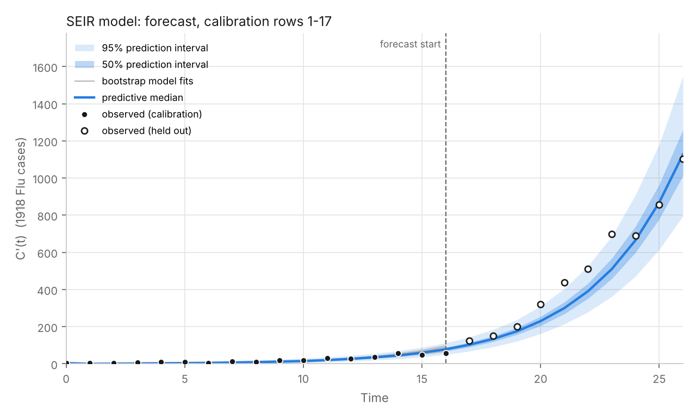

# QuantDiffForecast for Python

A Python port of the MATLAB toolbox [QuantDiffForecast](https://github.com/gchowell/QuantDiffForecast-Toolbox) (Chowell, Bleichrodt & Luo, *Statistics in Medicine* 2024, [doi:10.1002/sim.10036](https://doi.org/10.1002/sim.10036)). It fits ODE models to one or more time series, quantifies parameter uncertainty by parametric bootstrap, forecasts with prediction intervals and scores the forecasts.

This document has two parts: **how to use the port**, and **how the conversion was done**, so that you can maintain it, extend it, or port future MATLAB changes yourself.

## Install

Python 3.9 or later. The only dependencies are NumPy, SciPy, pandas, matplotlib and joblib. No MATLAB toolboxes are needed.

```bash
pip install "git+https://github.com/gchowell/QuantDiffForecast-Toolbox.git#subdirectory=python"
```

To work on the code, or to run the tests and demos, install from a clone instead:

```bash
git clone https://github.com/gchowell/QuantDiffForecast-Toolbox.git
cd QuantDiffForecast-Toolbox/python
pip install -e ".[test]"
python -m pytest -q         # 36 checks, about one minute
```

## Quick start

```python
import quantdiffforecast as q
from quantdiffforecast.examples import options_forecast_SEIR_flu1918_dist1_3

opts = options_forecast_SEIR_flu1918_dist1_3()
res = q.run_forecasting(opts, 1, 1, 17, 10, seed=1, n_jobs=-1)

s = res.windows[0].series[0]
print(s.forecast_table.iloc[17:27])            # held-out days: data, median, LB, UB
print(s.scores_by_horizon.iloc[-1])            # day 10 alone
print(s.performance_forecasting.iloc[-1])      # days 1-10 together
print(res.parameters.T)                        # estimates and 95% bootstrap intervals
```

The equivalent MATLAB session is

```matlab
forecastOptions = @options_forecast_SEIR_flu1918_dist1_3;
rng(1, 'twister');
Run_Forecasting_ODEModel(forecastOptions, 1, 1, 17, 10);
```

CSV files with the MATLAB file names, `.npz` files (in place of `.mat`) and PNG figures are written to `output/` in the folder you run from, as in MATLAB. The three example datasets are installed with the package and found by name; your own data files go in `input/` in the folder you run from, or in any folder you pass as `input_dir=`. The quick start (300 bootstrap refits, 6,000 predictive draws) takes about 40 seconds on two CPU cores and 75 seconds on one. Four runnable scripts are in `demos/`, including a template for your own model and data.



| Task | MATLAB | Python |
| --- | --- | --- |
| Fit without forecasting | `Run_Fit_ODEModel(opts, 1, 1, 17)` | `q.run_fit(opts, 1, 1, 17, seed=1)` |
| Forecast | `Run_Forecasting_ODEModel(opts, 1, 1, 17, 10)` | `q.run_forecasting(opts, 1, 1, 17, 10, seed=1)` |
| Figures | `plotFit_ODEModel`, `plotForecast_ODEModel` | drawn by the runners; or `q.plot_fit(res)`, `q.plot_forecast(res)` |
| Trajectories before fitting | `plotODEModel(opts)` | `q.plot_ode_model(opts)` |
| Profile likelihood | `Run_ProfileLikelihood_ODEModel(opts, 1, 17, struct('paramIndex', 1))` | `q.run_profile_likelihood(opts, 1, 17, paramIndex=[0])` |
| Compare models | `quantdiffCompareForecasts(models, windows, 10, 'Run', true)` | `q.compare_forecasts(models, windows, 10, run=True)` |
| Ensemble | `run_ensemble(models, labels, -1, 17, 10, 'name')` | `q.run_ensemble(models, labels, -1, 17, 10, "name")` |
| Baseline | `baselineForecast(calib, 10, 'flat', 6000, 1)` | `q.baseline_forecast(calib, 10, "flat", 6000, 1)` |
| Score saved draws | `quantdiffForecastScores(draws, obs, 17, 10)` | `q.forecast_scores(draws, obs, 17, 10)` |
| Simulate | `Run_simulate_ODEModel(opts, 30, 5)` | `q.run_simulate(opts, 30, 5, seed=1)` |
| Parameter recovery | `Run_PracticalIdentifiability_ODEModel(opts, 30, 5, 20, [], dir)` | `q.run_practical_identifiability(opts, 30, 5, replicates=20, output_dir=dir)` |
| Recovery summary | `summarizeIdentifiability(...)` | `q.summarize_identifiability(...)` |

## Your own model and data

A model is a function with the MATLAB signature. An analysis is one `Options` object.

```python
import numpy as np
import quantdiffforecast as q

def SEIR1(t, x, p, extra0=None):          # p = [beta, kappa, gamma, N]; x = [S, E, I, R, C]
    inf = p[0] * x[0] * x[2] / p[3]
    return np.array([-inf, inf - p[1]*x[1], p[1]*x[1] - p[2]*x[2], p[2]*x[2], p[1]*x[1]])

opts = q.Options(
    cadfilename1="curve-flu1918SF", caddisease="1918 Flu", datatype="cases",
    method1=3, dist1=3, numstartpoints=10, B=300,
    model=q.Model(fc=SEIR1, name="SEIR model"),
    params=q.Params(label=[r"\beta", r"\kappa", r"\gamma", "N"],
                    LB=[0.001, 0, 0, 20], UB=[10, 2, 2, 1e6],
                    initial=[0.76, 1/1.9, 1/4.1, 550000],
                    fixed=[0, 1, 1, 1], fixI0=1,
                    composite=lambda P: P[:, 0] / P[:, 2], composite_name="R_0",
                    logscale=True, polish=True),
    vars=q.Vars(label=["S", "E", "I", "R", "C"], initial=[550000 - 4, 0, 4, 0, 4],
                fit_index=[4], fit_diff=[1]),      # 0-based: state C, fitted through its increments
    windowsize1=17, tstart1=1, tend1=1, getperformance=True, forecastingperiod=10)
```

Estimation methods and noise models are unchanged: `method1` 0 (least squares, with `dist1` 0, 1 or 2), 1 (Poisson), 3, 4, 5 (negative binomial with variance μ+αμ, μ+αμ², μ+αμ^d) and 6 (sum of absolute deviations, Laplace noise). Window-specific initial conditions use `vars.initialFcn = lambda p, x0, v: [...]`, where `v.window.priorCum[0]` is the count observed before the window.

---

# How the conversion was done

## 1. Read the toolbox as a pipeline, not as 90 files

The MATLAB code folder has about 19,000 lines in 88 files, but one pipeline runs through all of it:

```
options  ->  fit one window  ->  bootstrap refits  ->  predictive draws  ->  scores  ->  tables and figures
             (fit_model)        (AddErrorStructure)                       (computeWIS ...)
```

About 30 files are options variants, three are test suites, and the two large runners (`Run_Fit_ODEModel`, `Run_Forecasting_ODEModel`) are the same algorithm with horizon 0 or h. The plotters re-read saved files and redraw. Porting the pipeline once, and expressing the variants as data, is why the Python package is about 3,700 lines.

| MATLAB files | Python module | Contents |
| --- | --- | --- |
| `SEIR1`, `EXP`, `GGM`, `GLM`, `SEIR_unreported`, `R0s*` | `models.py` | ODE right-hand sides and composite functions |
| `options_*.m`, `quantdiffCheck*.m` | `config.py`, `examples/` | `Options`, `Model`, `Params`, `Vars`; validation; the bundled option sets |
| `quantdiffODEOptions`, `quantdiffInitialConditions`, `quantdiffObservationCurve`, `quantdiffObjectiveValue`, `parameterSearchODE`, `getAICc`, `get_nparams`, `quantdiffEffectiveN`, `quantdiffAICcCountAdjustment` | `core.py` | ODE solve, observation curve, the six objectives, AICc |
| `fit_model` | `optimizer.py` | Multi-start bounded optimization with the same scaling, polish and diagnostics |
| `AddErrorStructure`, `estimatePearsonDispersion`, `estimateLaplaceScale`, `quantdiffNegativeNoiseShare` | `noise.py` | Bootstrap and predictive noise |
| `computeforecastperformance`, `computeWIS`, `computeQuantiles`, `quantdiffForecastScores`, `computeScoresFromQuantiles` | `scoring.py` | MAE, MSE, coverage, WIS, per-lead scores |
| `baselineForecast` | `baseline.py` | Flat and trend baselines |
| `quantdiffPII`, `boundHitFractions`, `quantileMCSE` | `identifiability.py` | Interval-width and bound diagnostics |
| `Run_Fit_ODEModel`, `Run_Forecasting_ODEModel`, `Run_Forecasting_ODEModel2`, `qdf_forecast_matname` | `runners.py` | One rolling-window engine behind `run_fit` and `run_forecasting` |
| `plotFit_ODEModel`, `plotForecast_ODEModel`, `plotODEModel` | `plotting.py` | matplotlib figures |
| `Run_ProfileLikelihood_ODEModel` | `profile.py` | Adaptive profile walk, crossing refinement, status rules |
| `quantdiffCompareForecasts`, `run_ensemble`, `ensembleWeights`, `getensemble_linearpool_from_curves` | `compare.py` | Model comparison and linear-pool ensembles |
| `Run_simulate_ODEModel`, `Run_PracticalIdentifiability_ODEModel`, `summarizeIdentifiability` | `simulate.py` | Simulation and parameter-recovery studies |
| `qdfTestForecastScores`, `qdfTestInitialConditions`, `qdfSmokeTest*` | `tests/` | pytest versions of the same checks |

## 2. The translation decisions that matter

Most lines translate mechanically. These nine places do not, and each one changes results if done carelessly.

**Options functions become one object.** A MATLAB options function returns 13 or 15 positional outputs and sets `global method1` as a side effect. In Python, `Options` holds everything, including `method1`. There is no output order to preserve, and one object serves both fitting and forecasting. Variants are made with `opts.copy(B=100, method1=1)` in place of a copied file.

**Globals become an explicit context.** `parameterSearchODE` read six globals (`model params vars method1 timevect ydata`), and `fit_model` copied them to parallel workers by hand. `core.ObjectiveContext` carries the same six values as an object. This is what makes the bootstrap refits safe to run in parallel processes.

**Indexing.** Positions inside arrays are 0-based: `vars.fit_index = [4]` is MATLAB's `5`, and `p[3]` is `p(4)`. Window starts (`tstart1`, `tend1`) remain 1-based row numbers of the data file, because the README, the file names and the scientific description all speak of "rows 1–17". File names still write `fit_index-5`, so MATLAB and Python outputs can be laid side by side.

**`ode15s` becomes LSODA.** `scipy.integrate.odeint` (LSODA) switches between a stiff BDF method and a non-stiff Adams method, with the toolbox's tolerances (RelTol 1e-6, AbsTol 1e-8). MATLAB's `NonNegative` option has no SciPy equivalent, so `solve_ode` emulates it: the right-hand side is evaluated at `max(x, 0)` and a state at zero is not allowed to decrease. The `QDF_ODE_TOL` global override becomes the context manager `ode_tolerances(rtol, atol)`.

**`fmincon` + `MultiStart` becomes a multi-start L-BFGS-B.** SciPy has no MultiStart, so `fit_model` loops over the same start points (Latin hypercube over the box plus jittered copies of the seed) and keeps the best local solution. Everything that makes the MATLAB optimizer robust is reproduced: free coordinates mapped to the unit box, optional log10 search, objective divided by its value at the seed, failed ODE solves ranked above every valid value, the rescale pass, the stationarity check, the Nelder–Mead polish and the confirmation step. The local solver itself was a judgment call. SciPy's SQP (`SLSQP`) has no step-size stopping rule like fmincon's `StepTolerance`, and on this finite-difference objective one bootstrap refit ran for 185,000 evaluations. L-BFGS-B reaches the same optima (objective values agreeing to six significant digits or better on six test problems) and stops reliably. `params.optimOptions = {"Algorithm": "SLSQP"}` selects SLSQP.

**`quantile` is not `numpy.quantile`.** MATLAB's `quantile` places the sorted sample at probabilities (i − 0.5)/n. NumPy's default uses (i − 1)/(n − 1). Prediction limits, coverage and WIS all differ between the two. Every quantile in the package goes through `scoring.mquantile`, which is `np.quantile(..., method="hazen")`, the same rule as MATLAB. The ported score tests agree with the toolbox's reference values to 1e-8.

**Random numbers.** `rng(1, 'twister')` plus the global stream becomes a `numpy.random.Generator` passed explicitly (`seed=1`). `nbinrnd(r, p)` maps to `rng.negative_binomial(r, p)` with the same parameterization, `poissrnd` to `rng.poisson`, `normrnd` to `rng.normal`. Bootstrap datasets and predictive draws are generated in the parent process in a fixed order, and each refit gets its own child seed, so a run gives identical results with 1 or 8 workers. MATLAB and NumPy draw different numbers from the same seed, so bootstrap intervals agree statistically, not digit for digit.

**Column-major order.** MATLAB stacks several observed series with `datac(:)` and `reshape`, which run down columns. NumPy defaults to row order, so those calls carry `order="F"`. This only matters with two or more fitted series, which is why there is a two-series test.

**Files and figures.** `.mat` files become `.npz` with the same variable names (`forecast1`, `forecast2`, `data1`, `datalatest`, `Phatss_model1`, ...). CSV files keep their names and columns. The runners return a `RunResult` object, so plotting takes that object and no longer rebuilds file names. The quantile CSV, which MATLAB writes from the plotter, is written by the runner.

## 3. A syntax crib for porting further code

| MATLAB | Python |
| --- | --- |
| `function dx = f(t, x, p, extra0)` with `dx = zeros(5,1); dx(1,1) = ...` | `def f(t, x, p, extra0=None): return np.array([...])` |
| `p(4)`, `x(1,1)`, `A(end, :)` | `p[3]`, `x[0]`, `A[-1, :]` |
| `i:j` (inclusive) | `range(i, j + 1)`, slice `i-1:j` |
| `@(p, x0, vars) [p(4) - 4, 0, 4, 0, x0]` | `lambda p, x0, v: [p[3] - 4, 0, 4, 0, x0]` |
| `struct('a', 1)`, `s.a` | dataclass or `dict`; `s.a` or `s["a"]` |
| `isfield(s, 'x') && ~isempty(s.x)` | attribute with default `None`; `s.x is not None` |
| `[A; B]`, `[A B]` | `np.vstack([A, B])`, `np.column_stack([A, B])` |
| `x(:)`, `reshape(x, n, m)` | `x.flatten(order="F")`, `x.reshape(n, m, order="F")` |
| `cumsum`, `diff`, `abs([v(1); diff(v)])` | `np.cumsum`, `np.diff`, `np.abs(np.concatenate(([v[0]], np.diff(v))))` |
| `quantile(X', 0.975)'` | `mquantile(X, 0.975, axis=1)` |
| `gammaln`, `chi2inv(1 - a, 1)` | `scipy.special.gammaln`, `scipy.stats.chi2.ppf(1 - a, 1)` |
| `X \ y` | `np.linalg.lstsq(X, y, rcond=None)[0]` |
| `error('Pkg:id', ...)`, `warning('Pkg:id', ...)` | `raise QuantDiffForecastError("Pkg:id - ...")`, `warnings.warn("Pkg:id - ...")` |
| `try ... catch, f = Inf; end` | `try: ... except Exception: return np.inf` |
| `array2table` + `writetable` | `pd.DataFrame(...).to_csv(path, index=False)` |
| `save(f, 'a', 'b')`, `load(f)` | `np.savez_compressed(f, a=a, b=b)`, `np.load(f)` |
| `parfor`, `MultiStart('UseParallel', true)` | `joblib.Parallel(n_jobs=...)` (argument `n_jobs` of the runners) |
| `inputParser` name/value pairs | keyword arguments |
| `tiledlayout`, `nexttile`, `plot`, `hist` | `plt.subplots`, `ax.plot`, `ax.hist` |

## 4. How the port was checked

MATLAB was not available where the port was written, so it was validated against numbers the toolbox itself publishes: the reference constants inside its test files and the results stated in its README.

| Check | Reference | Python |
| --- | --- | --- |
| Poisson objective, β = 0.76, N = 550,000, rows 1–17 | −836.7267 | −836.7267 |
| Same, N = 1,000 with S(0) following N | 2670.0961 | 2670.0964 |
| Window-specific example, β = 0.58, I₀ = 8 | −859.7854 | −859.7854 |
| Alternative with I₀ = 5.7, E₀ = 10.4 | −859.9134 | −859.9134 |
| Per-lead WIS, log WIS, block totals, relative WIS (`qdfTestForecastScores`) | 20 constants | agree to 1e-8 |
| Quick start, mean WIS over ten days | about 49 | 48.4 |
| Quick start, 95% interval coverage | 7 of 10 | 7 of 10 |
| Window-specific model, 17 observations, mean WIS; coverage | about 280; 0 of 10 | 279.2; 0 of 10 |
| 20 observations: window-specific vs quick start | about 150 vs 320 | 146.9 vs 316.8 |
| Mean over three origins | about 181 vs 132 | 182.3 vs 130.1 |
| WIS ratio to trend and flat baselines | 0.30 and 0.11 | 0.30 and 0.11 |
| Coverage: least squares, Poisson, negative binomial | 2, 6, 7 of 10 | 2, 6, 7 of 10 |

`tests/` holds these as 36 automated checks: the two MATLAB no-fit test files ported one to one, and end-to-end runs of every estimation method, rolling windows, two observed series, comparison, ensemble, profile likelihood, simulation and recovery. A direct MATLAB-versus-Python run on your machine is still worth doing, and `demos/05_compare_with_matlab.py` automates it. Run the quick start in MATLAB (do not call `plotForecast_ODEModel` first, because it rewrites the Forecast CSV), then point the script at MATLAB's output folder:

```matlab
rng(1, 'twister');
Run_Forecasting_ODEModel(@options_forecast_SEIR_flu1918_dist1_3, 1, 1, 17, 10);
```

```bash
python demos/05_compare_with_matlab.py "/path/to/forecasting_odemodels code/output"
```

It prints PASS or FAIL for 21 comparisons in three groups:

| Group | What is compared | Expected agreement |
| --- | --- | --- |
| A | Python's likelihood and AICc evaluated at MATLAB's estimates; Python's scores computed on MATLAB's own predictive draws (read from the `.mat` file) | Near exact (1e-3 for AICc, 1e-6 for scores). No random numbers or optimizer are involved, so a failure here is a porting error. |
| B | Point estimates of β, R₀, α and AICc | A few significant digits (0.2% for β). Different optimizers and ODE solvers. |
| C | Bootstrap interval endpoints, prediction limits, MAE, WIS, coverage | Monte Carlo error. The script runs Python with several seeds, measures the seed-to-seed spread, and asks whether MATLAB's value is a plausible member of it. |

## 5. Differences and what is not ported

- **Random streams differ.** Point estimates, objective values and AICc are deterministic and match. Bootstrap intervals and scores match to Monte Carlo error.
- **Local optimizer.** L-BFGS-B replaces fmincon's SQP (section 2). Exit flags are mapped to fmincon's convention: 1 converged, 2 stopped on no further progress, 0 limit reached.
- **Parallelism** is over bootstrap refits (`n_jobs`), not over the start points of one fit. `params.useParallel` is accepted and ignored.
- **`numericalAudit`** (the per-refit optimizer record saved in MATLAB's `.mat` files) is reduced to the accepted/unresolved bootstrap counts and the point fit's diagnostics (`res.windows[i].fit_diagnostics`).
- **Profile likelihood**: the `simulate` option (synthetic-data experiment inside the profiler) is not ported; use `run_simulate` to create the data first.
- **`summarize_identifiability`** reports the recovery columns of the MATLAB summary but does not check the noise sidecar files.
- **Not ported:** the figure scripts `make_readme_figures`, `plot_PL_1918_examples` and `plotPracticalIdentifiabilityResults` (their computations are available through the functions above), the profile-likelihood option sets B, E and F (C is included as a pattern), `GetAdjustedFontSize`, `initialParams` (unused), and the standalone Windows/Mac executables.
- **Figures** are saved as PNG and closed. Pass `show=True` to a plot function, or call `matplotlib.pyplot.show()`, for interactive windows.

## Citation and license

Please cite the original work: Chowell G, Bleichrodt A, Luo R. Parameter estimation and forecasting with quantified uncertainty for ordinary differential equation models using QuantDiffForecast: A MATLAB toolbox and tutorial. *Statistics in Medicine*. 2024;43(9):1826–1848. doi:10.1002/sim.10036.

Distributed under CC0 1.0 Universal, like the MATLAB toolbox.
